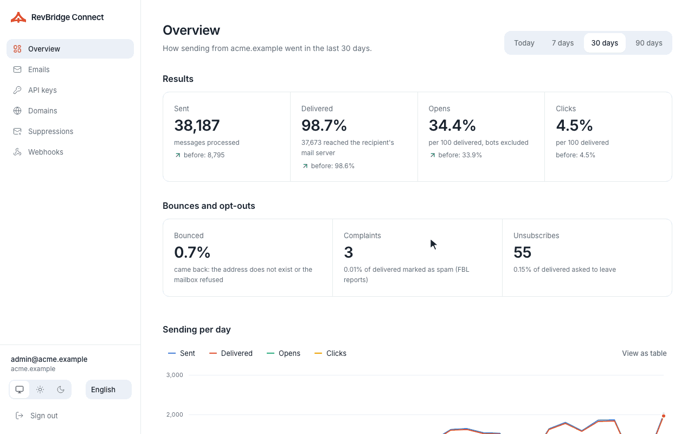
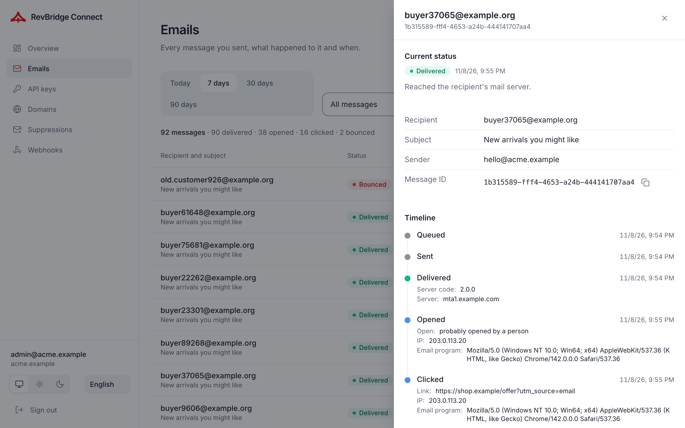
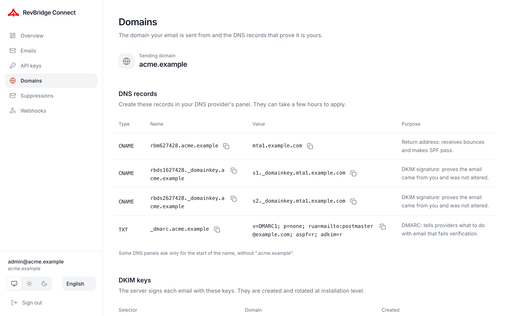
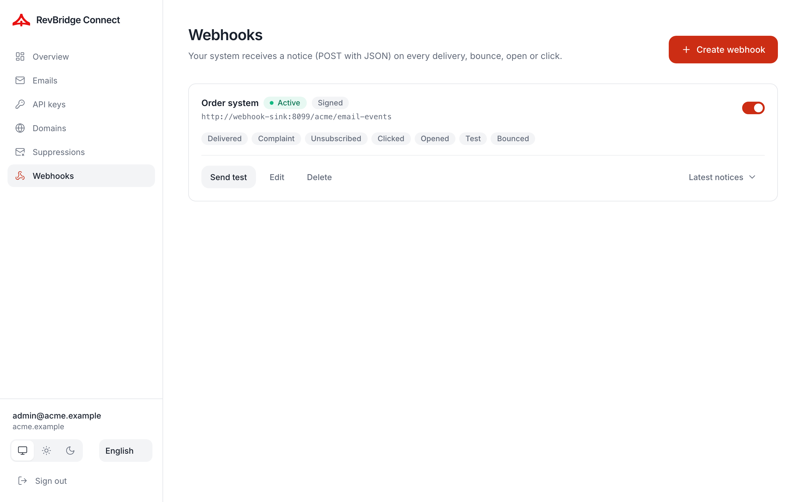
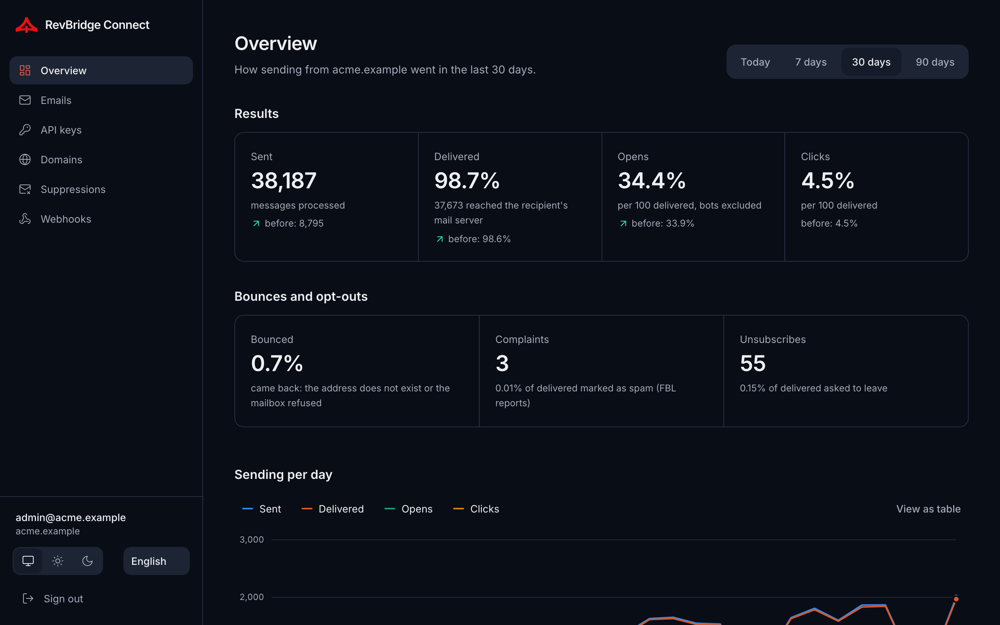
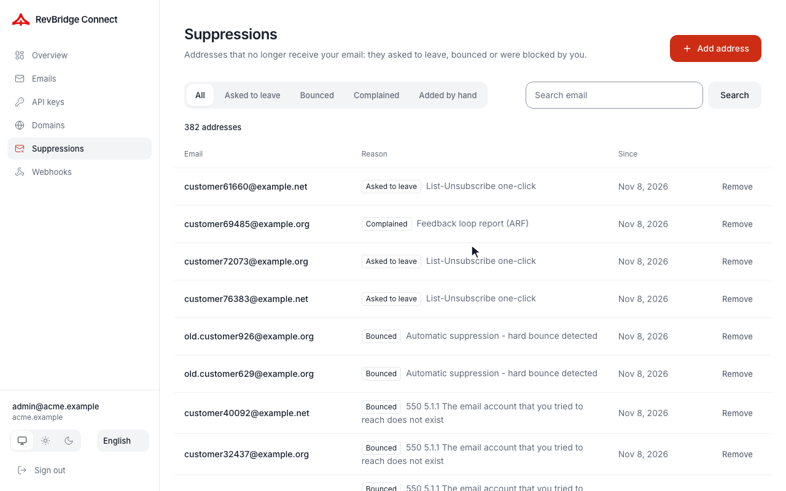
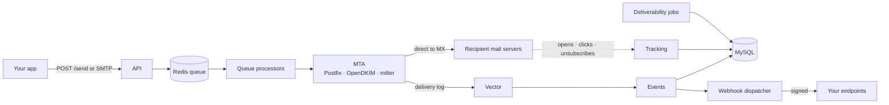

<p align="center">
  
</p>

<h1 align="center">RevBridge Connect</h1>

<p align="center">
  <strong>Self-hosted email sending, with the deliverability work already done.</strong><br>
  An HTTP API, SMTP, tracking, webhooks and a control panel that send from your own servers
  straight to your recipients' mail servers. No SendGrid, Mailgun or SES in the middle.
</p>

<p align="center">
  <a href="LICENSE"></a>
  
  
  <a href="CONTRIBUTING.md"></a>
</p>

<p align="center">
  <a href="#install-on-a-server-the-easy-way">Install on a server</a> ·
  <a href="#try-it-on-your-laptop">Try it</a> ·
  <a href="#how-it-works">How it works</a> ·
  <a href="docs/README.md">Docs</a> ·
  <a href="README.pt-BR.md">Português</a>
</p>

<p align="center">
  
</p>

## Why Connect

Hosted email APIs are easy until the bill grows with every email, your sending reputation sits
on IPs you do not control and your recipients' data lives on someone else's servers. A bare
Postfix fixes that and hands you a second job: DKIM, bounces, feedback loops, blocklists,
unsubscribe headers, tracking that is not fooled by scanners, a way to see what happened to an
email.

Connect is that second job, done and packaged. It is the open-source edition of the email
infrastructure [RevBridge](https://revbridge.ai) runs in production.

| | Hosted email API | Postfix on a VPS | **Connect** |
|---|:---:|:---:|:---:|
| Price grows with every email | yes | no | **no** |
| Sending IPs you own | paid extra | yes | **yes** |
| Your data stays on your servers | no | yes | **yes** |
| HTTP API, SMTP and signed webhooks | yes | — | **yes** |
| Opens and clicks without bot noise | yes | — | **yes** |
| Bounces, complaints and unsubscribes become suppressions | yes | by hand | **yes** |
| Blocklist monitoring | yes | — | **yes** |
| Control panel | yes | — | **yes** |

### Against the hosted APIs

| | **Connect** | Amazon SES | SendGrid | Mailgun |
|---|---|---|---|---|
| Cost model | your VPS, flat | per 1,000 emails | monthly plan with a volume cap | monthly plan with a volume cap and overage |
| Ballpark list price* | a VPS, from a few dollars a month | about $0.10 to $0.16 per 1,000 | plans from about $20 a month | plans from about $15 a month |
| Sending IPs | yours | shared, dedicated costs extra | shared, dedicated from the Pro plan | shared, dedicated on higher plans or as an add-on |
| Where the data lives | your server | AWS | their cloud | their cloud |
| Source code | Apache-2.0, all of it | closed | closed | closed |
| Opens and clicks without bot noise | yes | you build it | yes | yes |
| Suppressions from bounces and complaints | automatic | you build it | automatic | automatic |
| Warm-up of a new IP | you do it, the volume governor paces it | already warm (shared pool) | already warm (shared pool) | already warm (shared pool) |
| Needs outbound port 25 open | yes | no | no | no |
| Someone else runs the servers | no | yes | yes | yes |

\*Starting list prices read from each vendor's pricing page in November 2026, for orientation only. They change, so check the vendor's page.

**When a hosted API is the better choice:** a few thousand emails a month, nobody to look after a
server, or a cloud that blocks outbound port 25. Connect pays off when volume grows, when you want
the sending IPs and the data to be yours, or when you send for several customers from one place.

## Install on a server (the easy way)

One VPS is enough to start: a public IPv4 address, outbound port 25 open ([providers that allow it](docs/installation.md#which-providers-allow-outbound-port-25)) and a reverse DNS (PTR) record you can set (Ubuntu 24.04, 4 GB of RAM or more). Let your coding agent do it: [Claude Code](https://claude.com/claude-code) and [Codex](https://developers.openai.com/codex) both read the `start-here` skill in this repository.

Clone the repository, then pick the agent you use:

```bash
git clone https://github.com/revbridge-ai/revbridge-connect.git && cd revbridge-connect
```

| Option | Open it | Then type |
|---|---|---|
| **A. [Claude Code](https://claude.com/claude-code)** | `claude` | `/start-here` |
| **B. [Codex](https://developers.openai.com/codex)** | `codex` | `$start-here` |

Choose **Install on a server**. It asks for what it needs **once** (the server's IP and SSH key, the domain your email is sent from,
your email and a customer name), then:

1. checks the server without changing anything (SSH, system, outbound port 25, free ports);
2. writes your manifest outside the checkout and shows you the hostnames it picked;
3. after one OK from you, installs it on the server (about 10 minutes, it keeps going if your
   connection drops) and creates the first customer;
4. lists **every DNS record in one table**, finds where your DNS is hosted and writes a zone file
   to import; with Cloudflare it can create them for you with a token you run yourself, so no
   credential goes through the chat;
5. checks the DNS, starts the certificates, runs the full preflight and sends you a first test email.

You only do what needs you: set the IP's reverse DNS in your VPS panel, publish the DNS records,
and read the first email. Plan on about 30 minutes, most of it the build and DNS propagation.

## Try it on your laptop

Everything runs in Docker and the MTA delivers to [Mailpit](https://mailpit.axllent.org), a
local inbox, so nothing leaves your machine.

> **Using Claude Code or Codex?** Open the repository and type `/start-here` (Claude Code) or `$start-here` (Codex). It runs these steps with
> you, or walks you through a server install, checking each one before the next.

```bash
git clone https://github.com/revbridge-ai/revbridge-connect.git && cd revbridge-connect
make env build dev   # secrets, images (a few minutes the first time) and the whole stack
make demo            # a demo store: ~90 real sends through the pipeline + 40 days of synthetic history
```

Open the panel at **http://localhost:8088** with the login that `make demo` prints, and the
inbox at http://localhost:8025. You need Docker with Compose v2, Python 3.11+, `make` and
`openssl`.

Then send your own email with the demo store's API key:

```bash
export API_KEY=$(python3 -c 'import json; print(json.load(open("/tmp/connect-demo/bootstrap.json"))["api_key"])')

curl -X POST http://localhost:8001/send \
  -H "Authorization: Bearer $API_KEY" -H "Content-Type: application/json" \
  -d '{
        "personalizations": [{"to": [{"address": "you@example.org"}]}],
        "from": {"name": "Acme Store", "address": "hello@acme.example"},
        "subject": "Your order has shipped",
        "content": [{"type": "text/html", "value": "<p>It is on its way. <a href=\"https://example.org/track\">Track it</a></p>"}]
      }'
```

In Mailpit you will see it DKIM-signed, with tracked links and a one-click `List-Unsubscribe`
header. In the panel, open *Emails* to follow it from queued to delivered, opened and clicked.

## What you get

<table>
  <tr>
    <td width="50%"></td>
    <td width="50%"></td>
  </tr>
  <tr>
    <td><b>Every email, every step.</b> Queued, sent, the receiving server's answer, opens by
    people (not by scanners or Apple's privacy proxy) and clicks, per recipient.</td>
    <td><b>DNS records you can copy.</b> Return path, two DKIM selectors and DMARC, delegated by
    CNAME so keys can rotate without touching your DNS again.</td>
  </tr>
  <tr>
    <td></td>
    <td></td>
  </tr>
  <tr>
    <td><b>Signed webhooks.</b> Delivered, bounced, opened, clicked, unsubscribed and complaint
    events, signed with HMAC-SHA256 and retried with backoff.</td>
    <td><b>A panel for the whole team.</b> Delivery, open, click, bounce, complaint and
    unsubscribe rates against the previous period, in English or Portuguese, light or dark.</td>
  </tr>
</table>

- **Send** with `POST /send` (batch personalizations, merge tags, idempotency keys) or over
  authenticated SMTP on 587/465, where the API key is the password.
- **Deliver directly** to each recipient's MX through Postfix, with DKIM signing, a VERP return
  path that aligns SPF, and RFC 8058 one-click unsubscribe, which Gmail and Yahoo require from
  bulk senders.
- **Many customers, one installation**: each tenant has its own domains, keys, users, webhooks
  and data, isolated from the others.
- **Metrics without a vendor**: Prometheus at `/metrics` on the internal network.

## Deliverability, built in

<p align="center">
  
</p>

Landing in the inbox is the hard part of sending email, so Connect ships the automation a team
running its own mail servers would otherwise write:

- **Suppressions that maintain themselves.** Hard bounces (immediate or arriving later as a
  DSN), spam reports from feedback loops (ARF) and unsubscribes stop further sends to that
  address, automatically. A reported bounce or complaint must match a message in the send
  ledger, so forged ones are ignored.
- **A volume governor per sending domain.** Each domain has a daily quota that grows up to 1.3×
  a day while bounce and block rates stay low and is cut as soon as they rise. Sends above the
  quota wait for the next day instead of being dropped.
- **Unsubscribe that Gmail and Yahoo accept.** RFC 8058 one-click `List-Unsubscribe`, DKIM-signed,
  and a `Feedback-ID` so Gmail's complaint rate shows up per campaign in Postmaster Tools.
- **Honest engagement numbers.** Link scanners, prefetchers and Apple Mail Privacy Protection
  are filtered, so an open or a click means a person.
- **Hourly audits** of SPF, DKIM, DMARC and reverse DNS for every domain, and blocklist checks
  for every sending IP. Moving traffic off a listed or unhealthy node across several
  sending nodes is on the [roadmap](CHANGELOG.md#roadmap); today an installation has one sending IP.

The details, and what to do when a provider starts throttling you, are in
[docs/deliverability.md](docs/deliverability.md).

## For developers

Every event reaches your endpoint as JSON, signed with your webhook's secret:

```python
import hashlib, hmac

def is_from_connect(secret: str, raw_body: bytes, signature_header: str) -> bool:
    expected = "sha256=" + hmac.new(secret.encode(), raw_body, hashlib.sha256).hexdigest()
    return hmac.compare_digest(expected, signature_header or "")  # X-Webhook-Signature
```

The API is documented in [docs/api.md](docs/api.md), with OpenAPI specs in
[docs/openapi](docs/openapi). Webhook payloads and retries are in
[docs/webhooks.md](docs/webhooks.md).

## Run it in production

The guided install is at the top of this page ([Install on a server](#install-on-a-server-the-easy-way)). The manual steps:

### The same steps by hand

From your machine:

```bash
scripts/check-vps.sh root@203.0.113.10                      # read-only: port 25, system, resources
scripts/init_manifest.py --ip 203.0.113.10 --domain acme.com --email you@acme.com   # manifest outside the checkout
scripts/deploy.sh root@203.0.113.10                         # Docker, firewall, build, start (runs on the server)
scripts/first_customer.sh root@203.0.113.10 --domain acme.com --customer Acme --admin-email you@acme.com
scripts/go_live.sh root@203.0.113.10                        # checks the DNS, starts the certificates
```

`first_customer.sh` prints every DNS record in one table, finds where your DNS is hosted and writes a
zone file to import; with Cloudflare, `scripts/dns_records.py apply` can create them for you.
The preflight checks port 25, reverse DNS and the main blocklists before anything is sent.
[docs/installation.md](docs/installation.md) walks through DNS, TLS, the first sends and
warming up a new IP, which every new sending IP needs no matter which software sends.

## How it works



The milter rewrites links and adds the open pixel, the unsubscribe headers and the VERP return
path. Vector turns the Postfix log into delivery events. Caddy serves the panel and the
tracking domain with automatic TLS. [docs/architecture.md](docs/architecture.md) has the full
picture.

## Performance

On a single Docker VM (10-core laptop, 7.6 GB), the full pipeline delivered **48 emails per
second with 8 queue processors and 64 per second with 12**, while the API accepted bursts of
460 to 680 requests per second. Throughput grows almost linearly with `[scale]
queue_processors` in `connect.toml`; [docs/scaling.md](docs/scaling.md) has the method, the
knobs and how to size a VM. What real mailbox providers accept is bounded by the reputation of
your IPs, which is what warming up is for.

## Documentation

| Guide | |
|---|---|
| [Getting started](docs/getting-started.md) | local stack, first email, panel |
| [Installation](docs/installation.md) | VPS, DNS, PTR, TLS, preflight, warm-up |
| [Configuration](docs/configuration.md) | `connect.toml`, the variable catalog, secrets |
| [Architecture](docs/architecture.md) | services, data flow, storage |
| [API](docs/api.md) | authentication, sending, status, suppressions, reports |
| [Webhooks](docs/webhooks.md) | events, payloads, signature verification, retries |
| [Deliverability](docs/deliverability.md) | warm-up, bounces, complaints, jobs |
| [Scaling](docs/scaling.md) | measured throughput and sizing |
| [Security](docs/security.md) | threat model and hardening |
| [Operations](docs/operations.md) | backups, upgrades, logs, metrics, troubleshooting |
| [Development](docs/development.md) | repository layout and tests |

## Status

Connect is young as an open-source project, and its core has been sending for RevBridge in
production. Sending, tracking, bounces, complaints, webhooks, the panel and tenant isolation
are covered by end-to-end suites that run against a fresh local stack (`make test`). Adding
sending nodes from the command line is next on the [roadmap](CHANGELOG.md#roadmap).

Questions, bugs and ideas are welcome in the issues. Read [CONTRIBUTING.md](CONTRIBUTING.md)
before a pull request and [SECURITY.md](SECURITY.md) to report a vulnerability privately.

## License

Apache License 2.0. See [LICENSE](LICENSE) and [NOTICE](NOTICE).

<p align="center"><sub>Made by <a href="https://revbridge.ai">RevBridge</a>.</sub></p>
