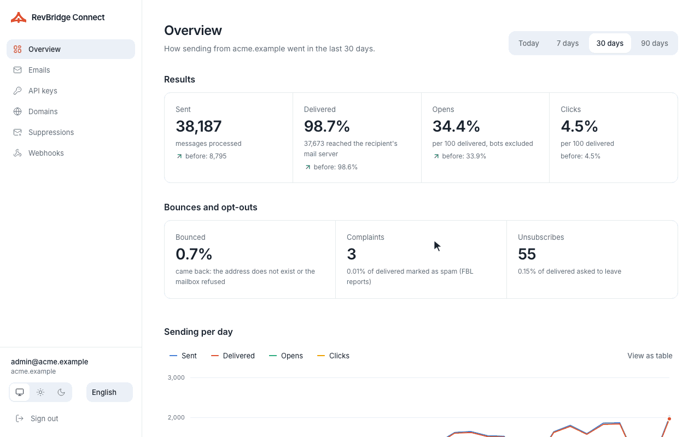
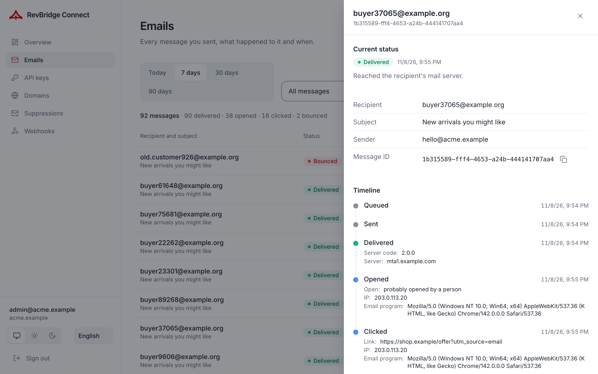
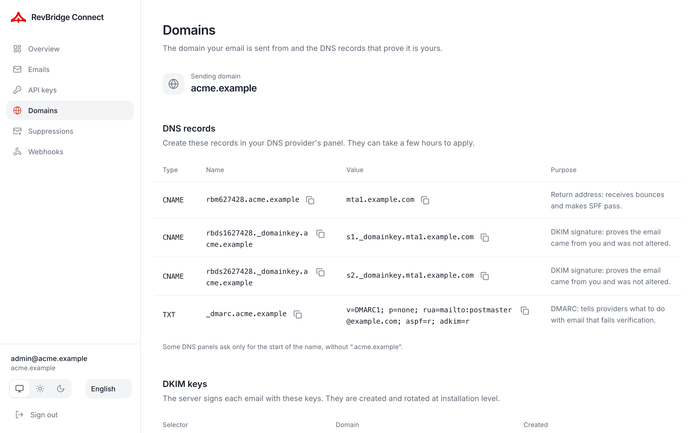
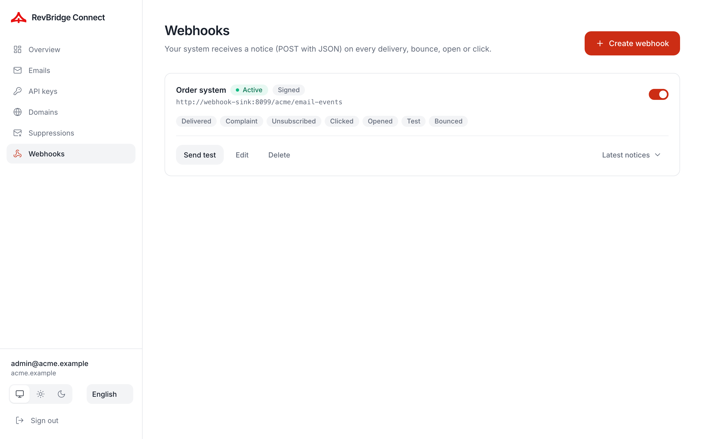
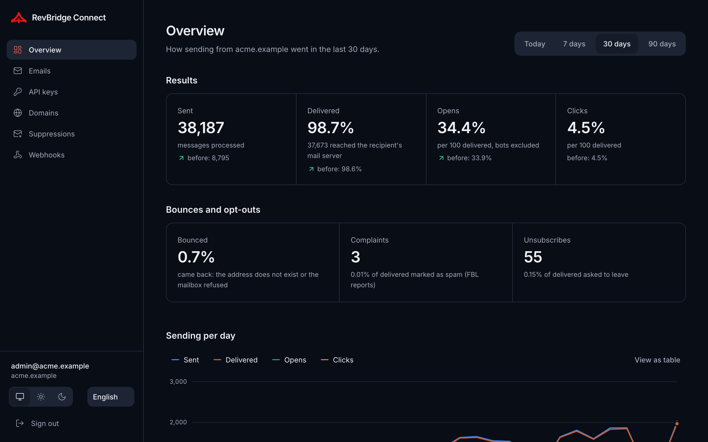
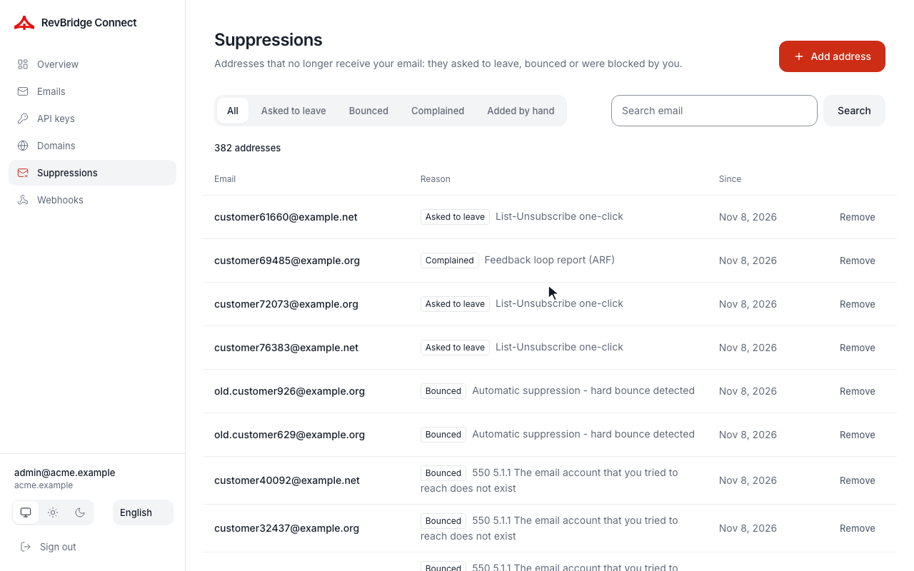
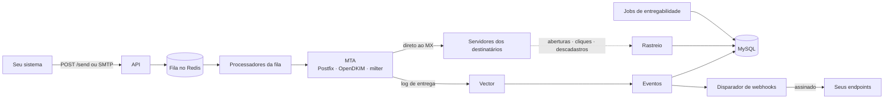

<p align="center">
  
</p>

<h1 align="center">RevBridge Connect</h1>

<p align="center">
  <strong>Envio de e-mail no seu próprio servidor, com o trabalho de entregabilidade já feito.</strong><br>
  API HTTP, SMTP, rastreio, webhooks e painel de controle que enviam dos seus servidores
  direto para o servidor de cada destinatário. Sem SendGrid, Mailgun ou SES no meio.
</p>

<p align="center">
  <a href="LICENSE"></a>
  
  
  <a href="CONTRIBUTING.md"></a>
</p>

<p align="center">
  <a href="#instale-em-um-servidor-o-jeito-fácil">Instalar em um servidor</a> ·
  <a href="#experimente-no-seu-computador">Experimentar</a> ·
  <a href="#como-funciona">Como funciona</a> ·
  <a href="docs/README.md">Documentação (inglês)</a> ·
  <a href="README.md">English</a>
</p>

<p align="center">
  
</p>

## Por que o Connect

As APIs de e-mail hospedadas são práticas até a conta crescer a cada e-mail, sua reputação de
envio ficar em IPs que você não controla e os dados dos seus destinatários morarem no servidor
de outra empresa. Um Postfix puro resolve isso e te dá um segundo trabalho: DKIM, bounces,
feedback loops, blocklists, cabeçalhos de descadastro, rastreio que não se deixa enganar por
scanners e um jeito de ver o que aconteceu com cada e-mail.

O Connect é esse segundo trabalho, feito e empacotado. É a edição de código aberto da
infraestrutura de e-mail que a [RevBridge](https://revbridge.ai) roda em produção.

| | API de e-mail hospedada | Postfix numa VPS | **Connect** |
|---|:---:|:---:|:---:|
| Preço cresce a cada e-mail | sim | não | **não** |
| IPs de envio seus | custo extra | sim | **sim** |
| Seus dados ficam nos seus servidores | não | sim | **sim** |
| API HTTP, SMTP e webhooks assinados | sim | — | **sim** |
| Aberturas e cliques sem ruído de robô | sim | — | **sim** |
| Bounces, reclamações e descadastros viram supressão | sim | à mão | **sim** |
| Monitoramento de blocklist | sim | — | **sim** |
| Painel de controle | sim | — | **sim** |

### Contra as APIs hospedadas

| | **Connect** | Amazon SES | SendGrid | Mailgun |
|---|---|---|---|---|
| Modelo de custo | sua VPS, valor fixo | por 1.000 e-mails | plano mensal com limite de volume | plano mensal com limite de volume e excedente |
| Preço de tabela aproximado* | uma VPS, a partir de poucos dólares por mês | cerca de US$ 0,10 a 0,16 por 1.000 | planos a partir de uns US$ 20 por mês | planos a partir de uns US$ 15 por mês |
| IPs de envio | seus | compartilhados, dedicado custa extra | compartilhados, dedicado a partir do plano Pro | compartilhados, dedicado em planos maiores ou como adicional |
| Onde ficam os dados | seu servidor | AWS | na nuvem deles | na nuvem deles |
| Código-fonte | Apache-2.0, todo | fechado | fechado | fechado |
| Aberturas e cliques sem ruído de robô | sim | você constrói | sim | sim |
| Supressão por bounce e reclamação | automática | você constrói | automática | automática |
| Aquecimento de um IP novo | você faz, o controle de volume dita o ritmo | já aquecido (pool compartilhado) | já aquecido (pool compartilhado) | já aquecido (pool compartilhado) |
| Precisa da porta 25 de saída liberada | sim | não | não | não |
| Outra empresa cuida dos servidores | não | sim | sim | sim |

\*Preços de tabela iniciais, lidos na página de cada fornecedor em novembro de 2026, só para dar noção. Eles mudam, então confira na página do fornecedor.

**Quando uma API hospedada é a melhor escolha:** poucos milhares de e-mails por mês, ninguém para
cuidar de um servidor ou uma nuvem que bloqueia a porta 25 de saída. O Connect compensa quando o
volume cresce, quando você quer que os IPs e os dados sejam seus ou quando envia para vários
clientes de um só lugar.

## Instale em um servidor (o jeito fácil)

Uma VPS basta para começar: IPv4 público, porta 25 de saída liberada ([provedores que liberam](docs/installation.md#which-providers-allow-outbound-port-25)) e um DNS reverso (PTR) que você consiga configurar (Ubuntu 24.04, 4 GB de RAM ou mais). Deixe o seu agente de código fazer: o [Claude Code](https://claude.com/claude-code) e o [Codex](https://developers.openai.com/codex) leem a skill `start-here` deste repositório.

Clone o repositório e escolha o agente que você usa:

```bash
git clone https://github.com/revbridge-ai/revbridge-connect.git && cd revbridge-connect
```

| Opção | Abra com | Depois digite |
|---|---|---|
| **A. [Claude Code](https://claude.com/claude-code)** | `claude` | `/start-here` |
| **B. [Codex](https://developers.openai.com/codex)** | `codex` | `$start-here` |

Escolha **Install on a server**. Ele pergunta o que precisa **uma vez só** (o IP do servidor e a chave SSH, o domínio de onde o
e-mail é enviado, o seu e-mail e o nome de um cliente) e então:

1. confere o servidor sem alterar nada (SSH, sistema, porta 25 de saída, portas livres);
2. escreve o seu manifesto fora do repositório e mostra os nomes que escolheu;
3. depois de um OK seu, instala no servidor (uns 10 minutos, continua se a sua conexão cair) e
   cria o primeiro cliente;
4. lista **todos os registros DNS numa tabela só**, descobre onde o seu DNS está hospedado e gera um
   arquivo de zona para importar; na Cloudflare ele pode criá-los com um token que você mesmo roda,
   então nenhuma credencial passa pelo chat;
5. confere o DNS, liga os certificados, roda o preflight completo e manda um primeiro e-mail de teste.

Você só faz o que depende de você: configurar o DNS reverso no painel da VPS, publicar os
registros DNS e ler o primeiro e-mail. Conte uns 30 minutos, a maior parte é o build e a
propagação do DNS.

## Experimente no seu computador

Tudo roda em Docker e o MTA entrega no [Mailpit](https://mailpit.axllent.org), uma caixa de
entrada local. Nada sai da sua máquina.

> **Usa o Claude Code ou o Codex?** Abra o repositório e digite `/start-here` (Claude Code) ou `$start-here` (Codex). Ele faz estes passos com
> você, ou guia a instalação num servidor, conferindo cada passo antes do próximo.

```bash
git clone https://github.com/revbridge-ai/revbridge-connect.git && cd revbridge-connect
make env build dev   # segredos, imagens (alguns minutos na primeira vez) e a stack inteira
make demo            # uma loja de demonstração: ~90 envios reais pelo pipeline + 40 dias de histórico sintético
```

Abra o painel em **http://localhost:8088** com o login que o `make demo` imprime, e a caixa de
entrada em http://localhost:8025. Precisa de Docker com Compose v2, Python 3.11+, `make` e
`openssl`.

Depois, mande o seu próprio e-mail com a API key da loja de demonstração:

```bash
export API_KEY=$(python3 -c 'import json; print(json.load(open("/tmp/connect-demo/bootstrap.json"))["api_key"])')

curl -X POST http://localhost:8001/send \
  -H "Authorization: Bearer $API_KEY" -H "Content-Type: application/json" \
  -d '{
        "personalizations": [{"to": [{"address": "voce@example.org"}]}],
        "from": {"name": "Acme Store", "address": "hello@acme.example"},
        "subject": "Seu pedido foi enviado",
        "content": [{"type": "text/html", "value": "<p>Está a caminho. <a href=\"https://example.org/track\">Acompanhe</a></p>"}]
      }'
```

No Mailpit ele aparece assinado com DKIM, com links rastreados e o cabeçalho de descadastro
em um clique. No painel, abra *Emails* para acompanhar da fila até a entrega, a abertura e o
clique.

## O que tem

<table>
  <tr>
    <td width="50%"></td>
    <td width="50%"></td>
  </tr>
  <tr>
    <td><b>Cada e-mail, cada etapa.</b> Fila, envio, a resposta do servidor de destino,
    aberturas por pessoas (não por scanners nem pelo proxy de privacidade da Apple) e cliques,
    por destinatário.</td>
    <td><b>Registros DNS para copiar.</b> Caminho de retorno, dois seletores DKIM e DMARC,
    delegados por CNAME para as chaves girarem sem mexer de novo no seu DNS.</td>
  </tr>
  <tr>
    <td></td>
    <td></td>
  </tr>
  <tr>
    <td><b>Webhooks assinados.</b> Entregue, bounce, aberto, clicado, descadastro e reclamação,
    assinados com HMAC-SHA256 e reenviados com espera crescente.</td>
    <td><b>Um painel para o time todo.</b> Taxas de entrega, abertura, clique, bounce,
    reclamação e descadastro contra o período anterior, em inglês ou português, claro ou
    escuro.</td>
  </tr>
</table>

- **Envio** por `POST /send` (vários destinatários por chamada, variáveis, chave de
  idempotência) ou por SMTP autenticado nas portas 587/465, com a API key como senha.
- **Entrega direta** ao MX de cada destinatário pelo Postfix, com assinatura DKIM, caminho de
  retorno VERP que alinha o SPF e descadastro em um clique (RFC 8058), que Gmail e Yahoo exigem
  de quem envia em volume.
- **Vários clientes numa instalação**: cada um com seus domínios, chaves, usuários, webhooks e
  dados, isolados dos outros.
- **Métricas sem fornecedor**: Prometheus em `/metrics` na rede interna.

## Entregabilidade de fábrica

<p align="center">
  
</p>

Chegar à caixa de entrada é a parte difícil de enviar e-mail. Por isso o Connect já traz a
automação que um time com servidores de e-mail próprios teria de escrever:

- **Supressões que se mantêm sozinhas.** Bounce permanente (na hora ou depois, como DSN),
  denúncia de spam por feedback loop (ARF) e descadastro bloqueiam novos envios para o
  endereço, automaticamente. Bounce ou denúncia só vale se casar com uma mensagem do registro
  de envios, então falsificações são ignoradas.
- **Um regulador de volume por domínio de envio.** Cada domínio tem uma cota diária que cresce
  até 1,3× por dia enquanto as taxas de bounce e de bloqueio ficam baixas, e é cortada assim
  que elas sobem. O que passa da cota espera o dia seguinte, sem ser descartado.
- **Descadastro que o Gmail e o Yahoo aceitam.** `List-Unsubscribe` de um clique (RFC 8058) assinado
  com DKIM e um `Feedback-ID`, para a taxa de reclamação do Gmail aparecer por campanha no
  Postmaster Tools.
- **Números de engajamento honestos.** Scanners de link, pré-carregamentos e o Mail Privacy
  Protection da Apple são filtrados, então abertura e clique significam uma pessoa.
- **Auditorias de hora em hora** de SPF, DKIM, DMARC e DNS reverso de cada domínio, e consulta
  a blocklists de cada IP de envio. Tirar o tráfego de um nó listado ou doente entre vários nós de
  envio está no [roadmap](CHANGELOG.md#roadmap); hoje uma instalação tem um IP de envio.

Os detalhes, e o que fazer quando um provedor começa a te segurar, estão em
[docs/deliverability.md](docs/deliverability.md).

## Para quem desenvolve

Cada evento chega no seu endpoint em JSON, assinado com o segredo do seu webhook:

```python
import hashlib, hmac

def is_from_connect(secret: str, raw_body: bytes, signature_header: str) -> bool:
    expected = "sha256=" + hmac.new(secret.encode(), raw_body, hashlib.sha256).hexdigest()
    return hmac.compare_digest(expected, signature_header or "")  # X-Webhook-Signature
```

A API está em [docs/api.md](docs/api.md), com as especificações OpenAPI em
[docs/openapi](docs/openapi). Formato dos webhooks e reenvios em
[docs/webhooks.md](docs/webhooks.md).

## Em produção

A instalação guiada está no topo desta página ([Instale em um servidor](#instale-em-um-servidor-o-jeito-fácil)). Os passos manuais:

### Os mesmos passos à mão

Da sua máquina:

```bash
scripts/check-vps.sh root@203.0.113.10                      # só leitura: porta 25, sistema, recursos
scripts/init_manifest.py --ip 203.0.113.10 --domain acme.com --email voce@acme.com   # manifesto fora do repositório
scripts/deploy.sh root@203.0.113.10                         # Docker, firewall, build, start (roda no servidor)
scripts/first_customer.sh root@203.0.113.10 --domain acme.com --customer Acme --admin-email voce@acme.com
scripts/go_live.sh root@203.0.113.10                        # confere o DNS e liga os certificados
```

O `first_customer.sh` imprime todos os registros DNS numa tabela só, descobre onde o seu DNS está
hospedado e gera um arquivo de zona para importar; na Cloudflare, o `scripts/dns_records.py apply`
pode criá-los para você. O preflight confere a porta 25, o DNS reverso e as principais blocklists antes de qualquer
envio. O [docs/installation.md](docs/installation.md) cobre DNS, TLS, os primeiros envios e o
aquecimento do IP novo, que todo IP de envio novo precisa, seja qual for o software.

## Como funciona



O milter reescreve os links e põe o pixel de abertura, os cabeçalhos de descadastro e o
caminho de retorno VERP. O Vector transforma o log do Postfix em eventos de entrega. O Caddy
serve o painel e o domínio de rastreio com TLS automático. O
[docs/architecture.md](docs/architecture.md) tem o quadro completo.

## Desempenho

Numa única VM com Docker (notebook de 10 núcleos, 7,6 GB), o pipeline completo entregou **48
e-mails por segundo com 8 processadores de fila e 64 por segundo com 12**, enquanto a API
aceitava picos de 460 a 680 requisições por segundo. A vazão cresce quase linearmente com
`[scale] queue_processors` no `connect.toml`; o [docs/scaling.md](docs/scaling.md) tem o
método, os ajustes e como dimensionar a VM. O quanto os provedores de verdade aceitam depende
da reputação dos seus IPs, e é para isso que serve o aquecimento.

## Documentação (em inglês)

| Guia | |
|---|---|
| [Getting started](docs/getting-started.md) | stack local, primeiro e-mail, painel |
| [Installation](docs/installation.md) | VPS, DNS, PTR, TLS, preflight, aquecimento |
| [Configuration](docs/configuration.md) | `connect.toml`, catálogo de variáveis, segredos |
| [Architecture](docs/architecture.md) | serviços, fluxo de dados, armazenamento |
| [API](docs/api.md) | autenticação, envio, status, supressões, relatórios |
| [Webhooks](docs/webhooks.md) | eventos, formato, verificação de assinatura, reenvios |
| [Deliverability](docs/deliverability.md) | aquecimento, bounces, reclamações, jobs |
| [Scaling](docs/scaling.md) | vazão medida e dimensionamento |
| [Security](docs/security.md) | modelo de ameaças e endurecimento |
| [Operations](docs/operations.md) | backup, atualização, logs, métricas, problemas comuns |
| [Development](docs/development.md) | organização do repositório e testes |

## Situação

O Connect é novo como projeto aberto, e o núcleo dele já envia para a RevBridge em produção.
Envio, rastreio, bounces, reclamações, webhooks, painel e isolamento entre clientes são
cobertos por suítes ponta a ponta que rodam numa stack local zerada (`make test`). Acrescentar
nós de envio pela linha de comando é o próximo item do [roadmap](CHANGELOG.md#roadmap).

Perguntas, bugs e ideias são bem-vindos nas issues. Leia o [CONTRIBUTING.md](CONTRIBUTING.md)
antes de um pull request e o [SECURITY.md](SECURITY.md) para relatar uma vulnerabilidade em
particular.

## Licença

Apache License 2.0. Veja [LICENSE](LICENSE) e [NOTICE](NOTICE).

<p align="center"><sub>Feito pela <a href="https://revbridge.ai">RevBridge</a>.</sub></p>
